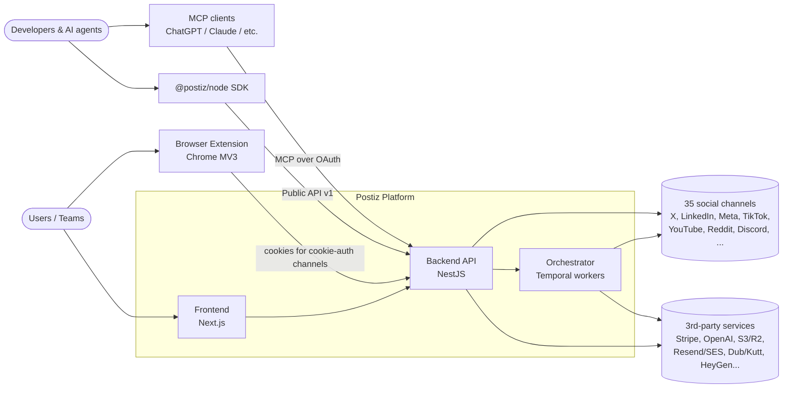
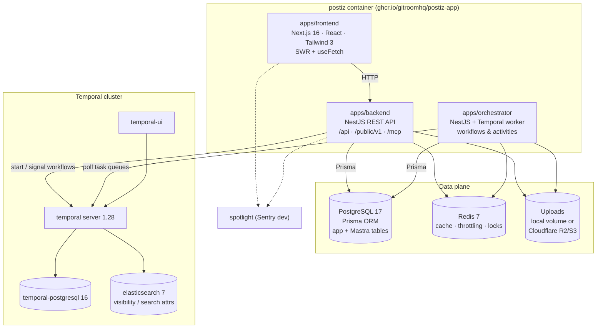
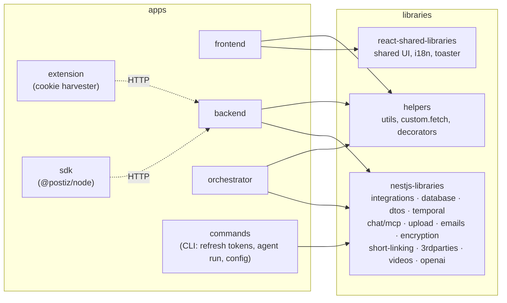
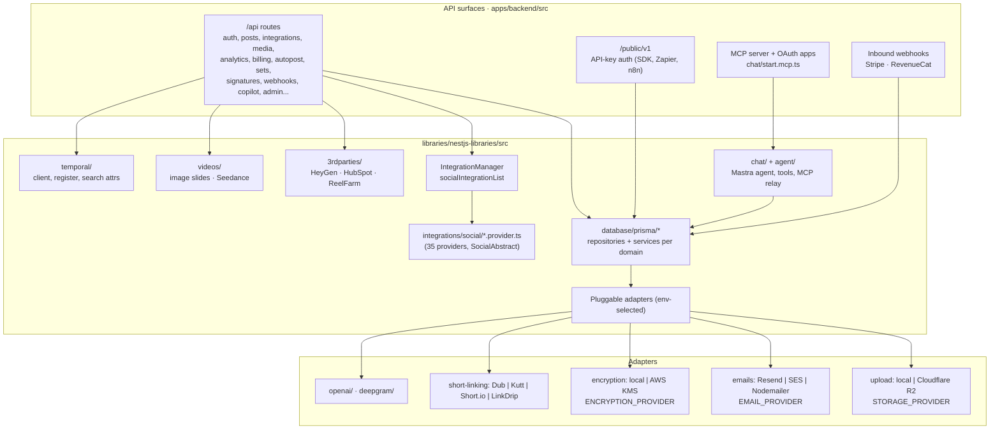
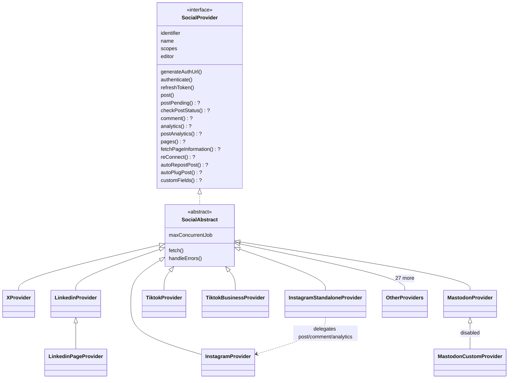
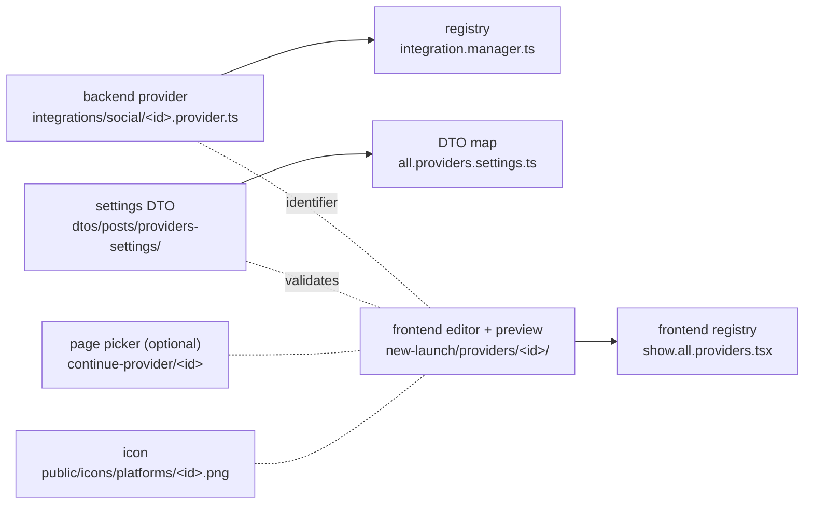
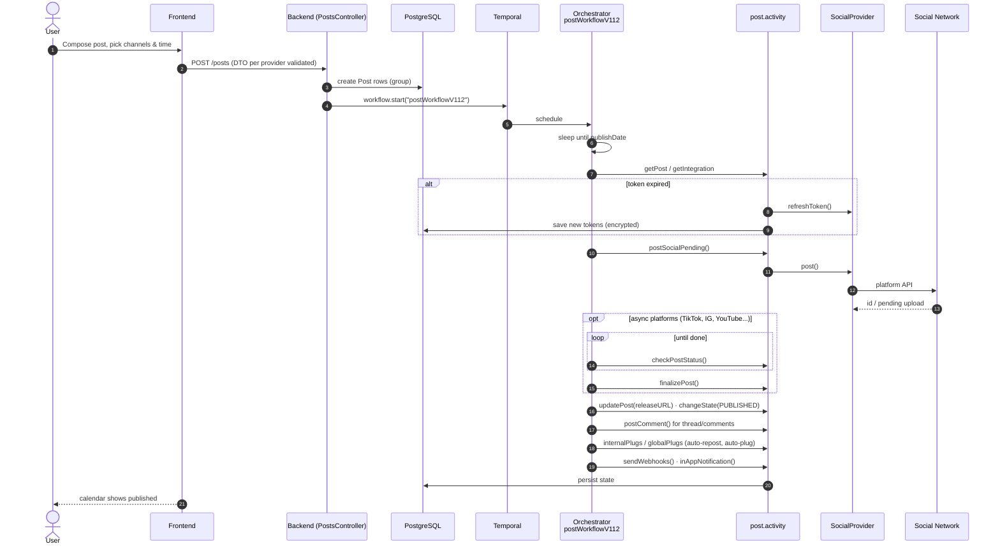
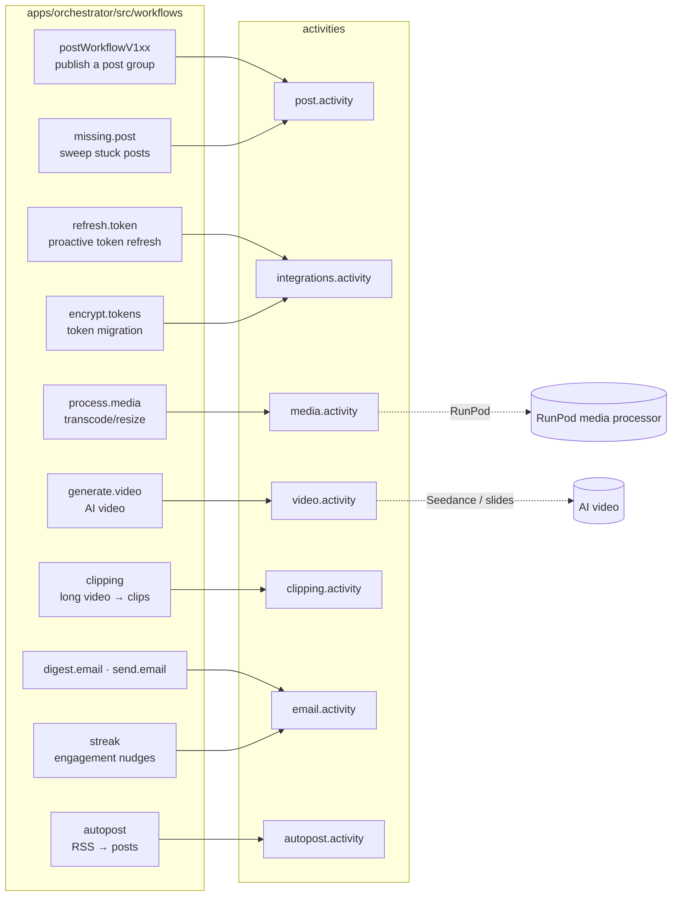
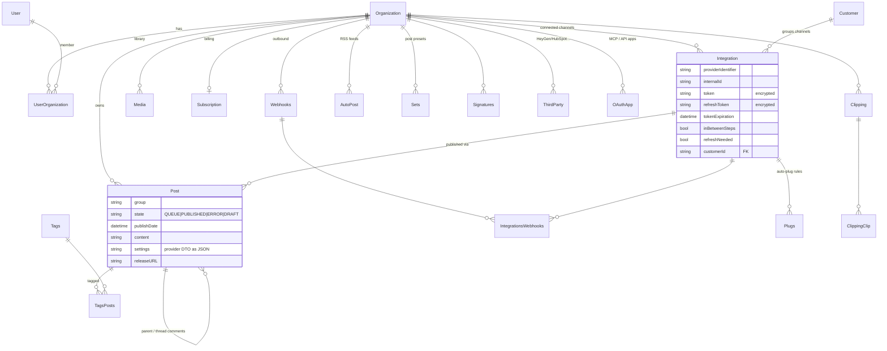

# Postiz Platform Architecture

This is an architecture overview of this Postiz fork. It was generated from the code at upstream `v2.26.0+` (`44df988c`).
All diagrams use [Mermaid](https://mermaid.js.org/) and render natively on GitHub.

---

## 1. System Context

---

## 2. Container / Deployment View

The services come from `docker-compose.yaml`. In production, the `postiz` image runs frontend, backend and orchestrator together under PM2, behind nginx.

---

## 3. Monorepo Structure

Layering rule from `CLAUDE.md`: **DTO → Controller → (Manager) → Service → Repository**.
Controllers live in `apps/backend`. Services and repositories live in `libraries/nestjs-libraries`.

---

## 4. Backend Internals

---

## 5. Channel (Provider) Architecture

Every channel is one class that implements `SocialProvider` and extends `SocialAbstract`. Generic code never branches on a specific channel. Channel-specific behaviour is added to the provider interface and implemented inside the provider.

Each channel touches these places:

Env controls: `HIDDEN_PROVIDERS` hides channels from the add-channel screen. `MIGRATE_PROVIDERS` (e.g. `tiktok:tiktok-business`) migrates channels in place on reconnect.

---

## 6. Post Publishing Flow

Errors go through `handleActivityError` and `markUnconfirmed`, and the post moves to the `ERROR` state with a notification.
**Workflows are versioned** (`post.workflow.v1.0.1` … `v1.1.2`). Never edit a workflow that is already on `main`. Add a new version instead.

---

## 7. Background Workflows (Temporal)

---

## 8. Data Model (core entities)

There are about 45 app tables plus about 50 `mastra_*` tables for the AI agent. These are the core relationships:

---

## 9. Extension Points for This Fork

| Goal | Where to extend | Conflict risk with upstream |
|---|---|---|
| New channel | New `*.provider.ts`, DTO, and frontend folder; register in 3 lists | Low for new files, **medium for the registries** |
| Channel variant | Subclass the existing provider (`LinkedinPageProvider` pattern) or delegate to it (`InstagramStandalone` pattern) | Low |
| Generic channel behaviour | Add an optional method to `SocialProvider`, call it generically, and implement it per provider | Medium |
| New background job | New workflow + activity in `apps/orchestrator` | Low |
| Change the publish flow | **New** `postWorkflowV1xx` file, then update the caller in `posts.service` | Medium |
| New storage/email/shortlink backend | New adapter that implements the interface, selected by env var | Low |
| New 3rd-party tool | `3rdparties/<name>/` + `thirdparty.manager.ts` | Low |
| AI agent tools / MCP | `chat/tools/` | Low |

Keeping fork-specific code in **new files** and limiting edits to the shared registries makes `git merge upstream/main` much easier.
